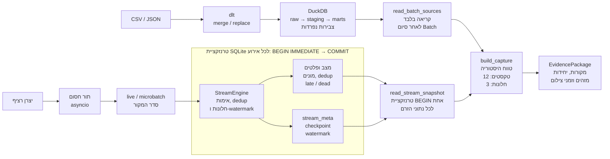
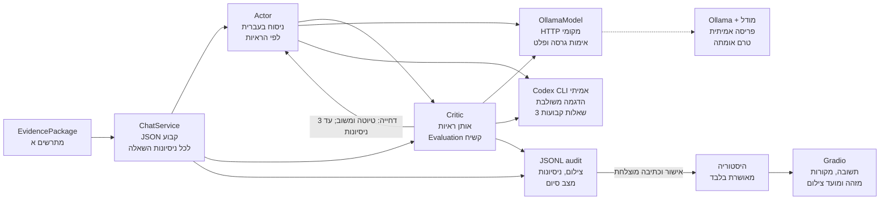

# ShopIL — דוח ארכיטקטורה וממצאים

## תחום הדוח ומצב האימות

המערכת מסבירה בעברית נתונים היסטוריים ואירועי מסחר באמצעות יוצר (Actor) ומעריך (Critic). הדוח עודכן ב־13 בנובמבר 2026 לאחר תיקוני PR 43 והדגמה משולבת אמיתית של PR 45. המערכת כוללת Batch מלא, זרם רציף, קוראי DuckDB ו־SQLite, חבילת ראיות, Gradio, לולאת משוב ויומן. בהדגמה החדשה הופעלו שבע קריאות מודל אמיתיות דרך Codex CLI מול נתוני הקורס המלאים ושלוש שאלות קבועות. נבחר gpt-6-astra; זהות הניתוב הפנימי של השירות אינה ידועה. מסלול Ollama הרגיל נבדק מול HTTP מתוסרט, אך לא מול פריסה אמיתית. בחירת ספק אינה דרישת המטלה.

## Batch: טעינה, ניקוי ומדדי מוצרים

קובצי CSV/JSON נטענים באמצעות dlt ל־DuckDB ומעובדים ב־dbt לשכבות `staging` ו־`marts`. הזמנות משתמשות ב־`merge` לפי `order_id` ובסמן `updated_at`; לקוחות, מוצרים וביקורות הם צילומי מצב ב־`replace`. הכפילויות והערכים הפסולים נשמרים בביקורות raw. הניקוי מסנן דירוגים מחוץ ל־1–5, מסיר רווחים בקצות הטקסט ומסנן ריקים, ואז שומר את הרשומה התקינה המוקדמת לכל `review_id`. בשוויון זמן נקבע סדר יציב לפי שדות הרשומה.

ב־Windows הורץ `integration.batch` פעמיים באותה סביבה ועם אותו warehouse ומצב dlt. התקבלו 600 הזמנות raw/staging, ‏549 תקינות, ו־402 ששולמו בסך 97,210.10 ש״ח; בהרצות החוזרות נכתבו אפס הזמנות. הביקורות עברו 310→304→298→289. השוואה עצמאית למקור אימתה מזהים בכל שלב וכל שדות הרשומה שנבחרה; 284 תגיות נשמרו בטבלת הילד. בכל ריצה נבנו שמונה מודלים, 25 בדיקות נתונים עברו ואחת התריעה על 19 הפניות ללקוח חסר; אפס שגיאות. זו אזהרת הקורס המקורית, וטבלת העובדות מסננת את הרשומות בחיבור ללקוחות. כל 14 בדיקות הקורס לשלבים 1–3 עברו.

ה־mart מסכם ביקורות והזמנות ששולמו בנפרד לפני החיבור לשמונה המוצרים. כך נמנעת הכפלת סכומים; `amount` כבר כולל כמות ואין להכפילו שוב. השוואה עצמאית של כל מוצר אימתה 289 ביקורות, 402 הזמנות ששולמו וסכום 97,210.10 ש״ח ללא שינוי בהרצה חוזרת. למוצר ללא ביקורות המודל שומר מונה אפס וממוצע NULL. הכנסה היסטורית היא בשקלים ומהזמנות ששולמו; הזרם מכיל אגורות וללא שדה מצב תשלום. המקורות נשארים נפרדים, ללא הנחת התאמת מזהי מוצרים או חיבור כספי ביניהם.

## זרם, חלונות ואמינות

יצרן רציף וצרכן פועלים במקביל דרך תור `asyncio` חסום. `run_live` מטפל ברשומה בכל פעם; `run_microbatch` אוסף לפי גודל או זמן המתנה מרביים, החל מהרשומה הראשונה. קבוצה חלקית משתחררת גם בלי הגעה נוספת; בסיום מתבצע `final_drain`. שני המסלולים שומרים את סדר המקור ומפעילים אותו מנוע, ללא מיון לפי זמן אירוע. קבוצה היא יחידת איסוף, בעוד חלון הוא שיוך עסקי לפי זמן האירוע.

לכל אירוע טרנזקציית SQLite עצמאית, גם בקבוצות: `BEGIN IMMEDIATE` עד `COMMIT` כוללים מצב חלונות, פלטים, מונים, מניעת כפילויות ו־`stream_meta.checkpoint`. כשל לפני commit אינו משאיר שינוי חלקי; אחרי commit נקודת ההמשך והפלט תואמים. `event_id` מונע ספירה עסקית חוזרת במיקום מקור חדש; מיקום שכבר נכלל ב־checkpoint מזוהה כקריאה חוזרת. כפולים, פסולים ומאוחרים מקדמים את נקודת ההמשך לפי חוזה המנוע בלי להגדיל סכום שהתקבל לצבירה. פסולים נשמרים ב־`dead_letters` ומאוחרים ב־`late_events`. זו עקביות מקומית במסד, לא הבטחת מסירה יחידה לכל מערכת חיצונית.

בתצורת ההוראה החלון הוא 60 שניות, כולל התחלה ולא כולל סוף; אי־הסדר הוא 0 ו־Grace הוא 10 שניות:

```text
watermark = max(previous_watermark, max_seen_event_time - out_of_order)
close_window = watermark >= window_end + grace
```

רק אירועים תקינים, ייחודיים ומתקבלים מקדמים את הזמן המרבי. שעון המחשב וטיימר הקבוצה אינם מקדמים watermark. הכנסה מתפרסמת בסגירה סופית; Grace גדול יותר מאפשר לקבל איחורים נוספים במחיר דחיית הפרסום. `finalize_demo` סוגר חלונות בסוף קלט ניסוי סופי בסיבה `demo_end_of_input`, בלי להזיז watermark. ניקוז או כיבוי היישום אינם סיבה לסגירת חלון עסקי. התראה נוצרת פעם אחת למוצר ולחלון בביקורת השלילית השלישית; הרביעית מעלה את המונה הנוכחי אך לא את מונה ההתראה שנרשם בעת ההפעלה.

## ראיות קבועות ותשובה עם משוב

`build_capture` מפעיל פעם אחת לשאלה את קורא ה־Batch ואת קורא הזרם, מחוץ ללולאת האירועים. כל קורא משתמש בטרנזקציית קריאה בלבד; אין טרנזקציה משותפת לשני המסדים ולכן כתיבות Batch חייבות להסתיים לפני הצ׳אט. קורא SQLite מקפיא יחד חמש טבלאות חלונות/התראות, מונים, תצורה, checkpoint ו־watermark. החיבורים נסגרים לפני קריאת מודל. קורא הזרם אינו מספק סכומי איחור, מזהי הזמנות או טקסטי ביקורות; שאילתות ניסוי ייעודיות אינן הופכות אותם אוטומטית לראיות היישום.

טווח ההיסטוריה המוגדר בדוגמה הוא `[2026-01-01,2027-01-01)`; ה־mart מציין בנפרד את כיסוי ההיסטוריה המלא. כל מדדי המוצרים נכללים, אך טקסט הביקורות מוגבל ל־12 האחרונות מכלל המוצרים, עם מספר זמין/נבחר/מושמט; אין זה מדגם מאוזן למוצר. ברירת המחדל בזרם היא שלושת זמני תחילת החלון האחרונים, עם כל המוצרים באותם חלונות והצהרה על השמטות. חריגה ממגבלת השורות מסתיימת בשגיאה ולא בקיטוע שקט. מונים כלליים מסומנים כמצטברים לכל ההרצה, בנפרד מהחלונות שנבחרו. שאלות אינן יוצרות SQL או משנות את הטווח מאליהן.

`EvidencePackage` כולל שאלה, מזהה וזמן צילום, מקורות, יחידות, מזהים, טווחים ושורות קבועות. SQL/Python מחשבים את המדדים; ILS נשמר כמחרוזת מדויקת ואגורות כמספר שלם. `ChatService` מקפיא JSON פעם אחת, ומעביר אותו ללא שינוי ליוצר, למעריך ולכל תיקון. שאלה חדשה קוראת מצב חדש; ראיות נוכחיות גוברות על מספרים ישנים בהיסטוריה. מקורות פתוחים וסגורים נפרדים, וחוסר מידע אינו אפס.

המעריך מחזיר `Evaluation` עם בוליאני קשיח `is_acceptable` ומשוב טקסטואלי. דחייה מחזירה ליוצר טיוטה ומשוב לצד אותן ראיות; המגבלה היא שלושה ניסיונות בסך הכול. שגיאת מודל או הערכה פגומה מסיימת את השאלה בשגיאה. רק אישור לאחר כתיבת יומן מוצלחת מעדכן היסטוריה; טיוטות שנדחו נשמרות ביומן JSONL נפרד. Gradio מציג תשובה, מקורות ומזהה/מועד צילום. אישור Critic אינו הוכחת אמת: בניסויי שפה אמיתיים נבדקו מול SQL תשובות 122 ש״ח שהתקבלו ו־13 שהוחרגו; טיוטת 135 נדחתה ותוקנה ל־122. ניסוי נוסף אישר 132 על סמך קלט חדש למרות היסטוריה של 122. שלוש דחיות נבדקו בנפרד במודלים מדומים.

## הפעלה וגבולות ההוכחה

`integration.batch` מריץ את כל שלבי ההכנה עם הפסקה בכשל, תוך ייצוא פרויקט dbt נקי לתיקיית ריצה חדשה ושמירת קובצי המעבדה הקיימים. `integration.run` דורש הצלחת Batch, מתחיל זרם וממתין ל־checkpoint חדש לפני הצ׳אט. Ctrl+C סוגר צ׳אט ומבקש ניקוז זרם באמצעות EOF; כיבוי כפוי מדווח ככשל. פקודות עצמאיות תומכות בשני מצבי הזרם ובצ׳אט. היישום ו־ETL משתמשים ב־Python 3.14.10; הזרם בסביבה נפרדת של 3.13.12.

מתאם ההפעלה הרגיל משתמש ב־Ollama מקומי, בודק גרסה ודוחה קיטוע או גלישת הקשר; אין כאן הוכחת פריסה אמיתית שלו. רתמת experiments.integrated_codex מריצה את אותו Batch, מפקח, צילום ראיות, Gradio ולולאת Actor/Critic עם Codex מאומת ושאלות קורס קבועות. כללי CLI וה־hooks נשארים פעילים; שאלות שרירותיות והיסטוריה מזויפת נדחות. בהדגמה הוזרקה טיוטת 999999 ש״ח שגויה, והמעריך האמיתי דחה אותה; היוצר תיקן ל־402 הזמנות ו־97,210.10 ש״ח ואושר. מוצר 5 הוצג עם 56 הזמנות ו־8,925.00 ש״ח, ועלויות משלוח כחסרות. המספרים, המקורות, היחידות וזמני הצילום נבדקו מול SQL; כיסוי ה־mart נפרד מהטווח השנתי. שלוש השאלות השתמשו ב־checkpoints ‏107, 994 ו־1611; הזרם התקדם בכל שבע קריאות המודל בלי לשנות ראיות בתוך שאלה. בסיום נוקזו 2264 מתוך 2264 משלוחים, checkpoint ‏2263 ללא סגירת חלונות מלאכותית. צולמו תשובות מתוך Gradio הפעיל. 322 בדיקות יישום מקומיות עברו; תוצאת CI הסופית נרשמת בנספח הבדיקה המצורף.

קוד הליבה `streaming_lab` מקורו ב־[מעבדת הזרם](https://github.com/paulavrahami/streaming-course-demo/tree/c27b4fc1b343e5bfca1880ad3c5ae34e97f60b71); הפירוט ב־[SOURCES.md](../streaming/SOURCES.md). צינור הבסיס ותשתית dbt מקורם ב־[מעבדת ETL](https://github.com/paulavrahami/etl-course-demo/tree/6788526695bbb20ac40f46a947413fff3545b86a). הביקורות פותחו מה־starter, ללא פתרונות המרצה. מעטפת הזרם, הקוראים, ההוכחות, הצ׳אט והמפקח הם פיתוח הפרויקט. תוצרי ריצה נבחרים מצורפים בנפרד מהקוד, ללא סודות או סביבות התקנה.

## תרשים המימוש וגבולות האימות

קווים רציפים מתארים מימוש שנבדק. ההדגמה המשולבת האמיתית מפעילה Codex CLI עם שאלות קבועות דרך אותו ממשק מודל של Actor/Critic. קו מקווקו ל־Ollama מציין פריסה חיצונית שלא אומתה מול מודל אמיתי; מתאם ה־HTTP עצמו נבדק. שמירת הראיות והמשוב אינה תלויה בספק.

### א. קליטה, טרנזקציות וצילום הנתונים



המפקח `integration.run` מפעיל Batch, ממתין להצלחתו, מתחיל זרם ורק לאחר checkpoint חדש מפעיל צ׳אט. שתי טרנזקציות הקריאה שייכות למסדים שונים; אין הבטחת צילום אטומי משותף. החיבורים נסגרים לפני הפנייה למודל. חבילת הראיות עוברת לתרשים ב.

### ב. שאלה, הערכה, משוב ופרסום



שאלה חדשה מפעילה build_capture ומקבלת מזהה וזמן צילום חדשים. בכשל או בשלוש דחיות לא מתפרסמת טיוטה להיסטוריה. ההדגמה האמיתית משתמשת בנתיב Codex המסומן; הנתיב המקווקו ל־Ollama נבדק באמצעות HTTP מתוסרט בלבד.

## תוצאות וגבולות האימות

| בדיקה | ממצא מתועד | גבול ההסקה |
| --- | --- | --- |
| Batch מלא פעמיים | 600 raw/staged orders; ‏549 תקינות; 402 ששולמו; 97,210.10 ש״ח; שמונה מוצרים | אותו warehouse ומצב dlt; אפס הזמנות חדשות בהרצות החוזרות |
| raw ביקורות פעמיים | 310 שורות, 300 מזהים שונים, 284 תגיות; כל שדות המקור והתגיות תואמים | replace אינו מוחק כפילויות עסקיות במקור |
| ניקוי ביקורות | 310→304→298→289; מזהים ורשומות מוקדמות מלאות תואמים למקור | לא רק ספירת שורות; נשמרו גם מועמדים כפולים ותוצאות SQL |
| mart ו־dbt מלא | כל שמונת המוצרים תואמים לחישוב עצמאי; 289 ביקורות, 402 paid, ‏97,210.10 ILS; שמונה מודלים, 25 בדיקות עברו ואזהרה אחת | אזהרת 19 לקוחות חסרים אינה שגיאה; מספר המודלים אינו מספר הבדיקות |
| capture משולב אמיתי | DuckDB היסטורי + SQLite הוראה: 402 paid/‏97,210.10 ILS, שמונה מוצרים, 12 מתוך 289 טקסטים, checkpoint ‏16 | בהרצת האימות הוגדרו ארבעה חלונות כדי לכלול את כל קלט ההוראה; ברירת המחדל היא שלושה |
| 17 משלוחי הוראה | 12,200 אגורות התקבלו; 1,300 איחרו; סך תקין וייחודי 13,500 | התאמה בתוך הזרם בלבד; החלון האחרון נסגר ב־`finalize_demo` |
| live מול microbatch | תוצאות עסקיות זהות בשלוש תשתיות קלט ובארבע תצורות; נבדקו שחרור לפי גודל, זמן וניקוז | זמני האיסוף והרכב הקבוצות תלויים בתזמון; סדר האירועים נשמר |
| Grace וכפילויות | באותם 300 אירועים ייחודיים, Grace ‏0/10/120 הותיר 21/14/0 מאוחרים; 17 כפילויות לא הגדילו הכנסה; המשך לאחר checkpoint ‏15 תאם לריצה רציפה | ניסויי קלט קבוע, מסד חדש לכל תרחיש; אינם הבטחת מסירה יחידה למערכת חיצונית |
| דחייה ותיקון אמיתיים | טיוטת 135 נדחתה; תשובת 122 אושרה באותו snapshot | Codex CLI מאומת ונתוני הוראה קבועים; לא פריסת Ollama של היישום |
| המשך וחוסר מידע | תשובה מאושרת: 13 ש״ח הוחרגו; רווח נקי אינו זמין ללא עלויות | שאלת המשך מקבלת צילום חדש; חוסר אינו אפס |
| היסטוריה ישנה | לאחר שינוי `order-a` לפני קליטה, SQL ו־Actor: ‏132 ILS למרות היסטוריה של 122 | אירוע ועותק הניסיון החוזר שונו יחד; לא בוצע שינוי SQL בתוצאה |
| שלוש דחיות ומקביליות | שלושה ניסיונות ללא פרסום; בשני מצבי הזרם checkpoint ‏2→5 בזמן תשובה, הצילום הפעיל נשאר קבוע והבא מתעדכן | מודלים מתוסרטים במפורש; תהליכי זרם ו־SQLite אמיתיים |
| קליטה פעילה וכיבוי | צילום monitor: checkpoint ‏8→16→24; בסיום produced=consumed=28, קוד 0, ללא finalize | צילום רכיב זרם אמיתי, לא צילום תשובת הצ׳אט המשולב |
| חזרת מערכת מלאה עם HTTP מתוסרט | Batch לפני stream/chat; שתי תשובות 97,210.10 ILS; checkpoint ‏40→45 ובשאלה הבאה 48→53 בזמן המתנת Actor; ניקוז 80/80, checkpoint ‏79 | כל נתיבי היישום והמסדים אמיתיים; רק תשובות שרת המודל מתוסרטות. אותן ראיות ב־Actor/Critic, צילום חדש לשאלה הבאה; אין צילום תשובת מודל אמיתי |
| הדגמה משולבת אמיתית — PR 45 | 7 קריאות מודל; דחייה ותיקון; 3 תשובות; 2264/2264 ניקוז; צילומי Gradio חיים | שאלות קבועות ונתוני קורס בלבד; מקור ותזמון נשמרו; אין טענה לפריסת Ollama |
| CI של PR 37 ב־`7254e29` | Windows/macOS/Linux ובדיקת guard עברו; 258 בדיקות יישום ו־107 זרם; Batch פעמיים | בדיקות HTTP וממשק מתוסרטות אינן הוכחת איכות של מודל מקומי אמיתי |

ראיות Batch נמצאות מחוץ ל־Git ב־`work/etl-validation/integrated-batch-run1` וב־`integrated-batch-run2`, כולל SQL ושורות, dbt results, פלט קורס והוכחה ש־85 קובצי פרויקט המעבדה הקיימים נשמרו. `work/etl-validation/reviews/stage.json` מתעד מזהים ורשומות בכללי הניקוי. `work/combined-capture-validation.json` מתעד את החבילה האמיתית המשולבת, עם 12 טקסטים נבחרים ו־277 מושמטים; המדדים הכספיים נותרים נפרדים.

ניסויי הזרם השמורים מפרטים [live מול microbatch](../streaming/evidence/SHOPIL-39/README.md), [תנאי שחרור קבוצה](../streaming/evidence/SHOPIL-20/README.md), [גבולות חלונות ו־Grace](../streaming/evidence/SHOPIL-40/README.md) ו־[כפילויות והמשך מנקודת עצירה](../streaming/evidence/SHOPIL-41/README.md), כולל פקודות, קלט ותוצאות להשוואה.

ניסוי התיקון העדכני נשמר ב־`runs/chat-evaluation-f692c73596d345418a774ca35b6be661`, עם מקור ותצורה מתועדים ו־Codex CLI ‏0.162.0. ניסוי השיחה נשמר ב־`runs/conversation-9b3830feb24f403185f4b0f3fde55710`, וניסוי ההיסטוריה הישנה ב־`runs/actor-current-6f3fac5fcd1741d19ec70e9e5ed1481e`. נבדקו מספרים, מזהים, יחידות וזמנים מול SQL; לא נצפו קריאות לכלים בניסויי השפה. זהות המודל המדויקת לא נחשפה ביומני CLI. ניסויים אלו אינם מתאם למידע שרירותי או חלופה לשרת המודל ביישום.

צילום הקליטה הפעילה והוכחת הניקוז נמצאים ב־evidence/active-stream וב־evidence/screenshots. ההדגמה המשולבת החדשה נשמרה ב־runs/integrated-live-20261113T172110Z ומצורפת כ־evidence/chat/integrated-live: נתוני סביבה, בקשות ותשובות אמיתיות, יומנים, צילומי ראיות, בדיקת SQL וסקירה ידנית. שלושת צילומי Gradio הם מההרצה הפעילה. רתמות ההפעלה והדפדפן מצורפות לצורך שחזור, עם נתיבי הסביבה שתועדו. דוח PDF זה כולל עד שלושה עמודי הסבר; תרשימים ותוצאות מופיעים בנספחים נפרדים. הרצות ישנות נשמרו עם התוויות המקוריות, לרבות HTTP מתוסרט והצגת תשובה מוקלטת; הן אינן מוצגות כקריאות חיות. לא בוצעה הגשה למודל.